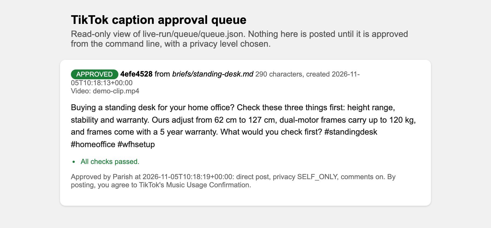
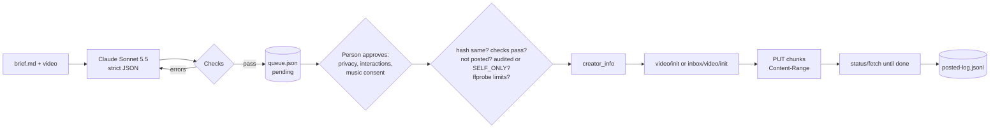
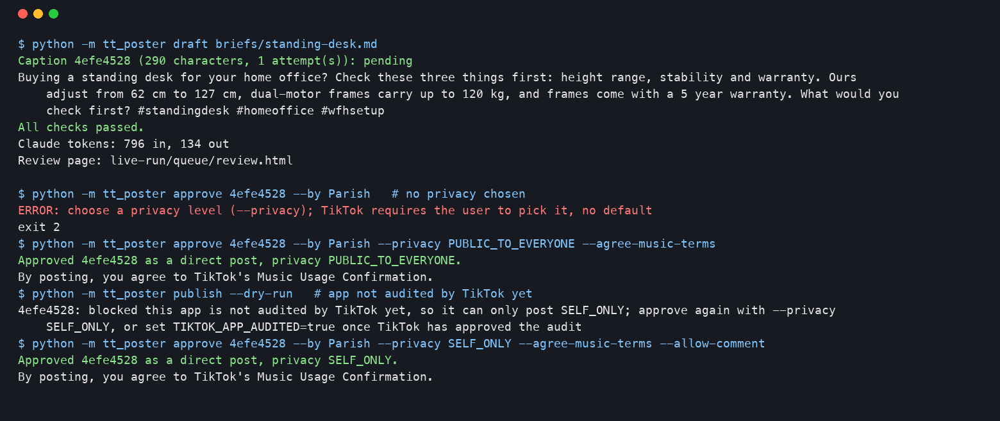
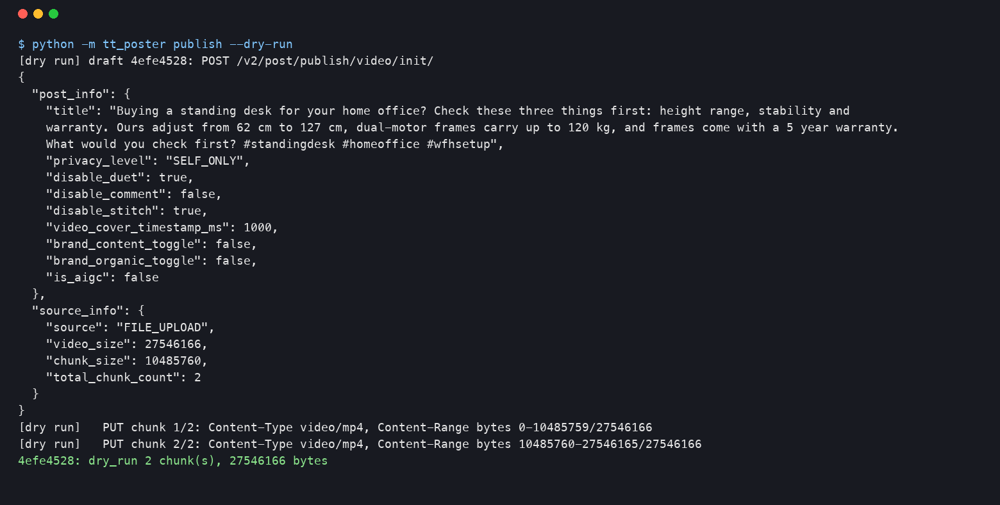
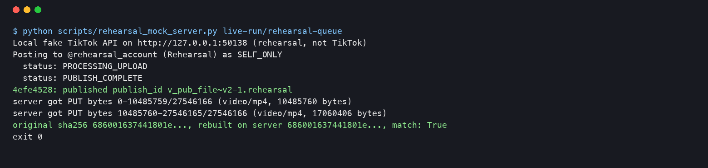

# TikTok Content Posting Client

Claude writes a TikTok caption and hashtags from a short brief. The caption is checked and then waits in an **approval queue**. **Nothing is posted until a person approves it** and chooses the privacy level themselves. Approved videos go to the creator's own account through TikTok's official **Content Posting API**:

- Login Kit OAuth sign-in
- a fresh `creator_info` check before every post
- direct post or upload to the TikTok inbox
- chunked file upload
- status polling until TikTok finishes processing



*A real run on 2026-11-05: Claude wrote the caption from `briefs/standing-desk.md`, using only the brief's facts.*

## TikTok's rules, and how this tool keeps to them

- **Official API only:** Login Kit and the Content Posting API. No browser automation, no unofficial endpoints.
- **Unaudited apps can only post privately.** Until TikTok audits an app, every post must be `SELF_ONLY`, to an account set to private, and at most 5 accounts can use it in 24 hours.
  - The tool knows this (`TIKTOK_APP_AUDITED=false` by default). It stops a public post **before** calling TikTok, with a plain explanation instead of a 403.
  - If TikTok's `unaudited_client_can_only_post_to_private_accounts` error comes back anyway, it gets the same plain message.
- **Sandbox mode** exists for testing with up to 10 of your own accounts. It also only allows private posts.
- **The Content Sharing Guidelines are followed:**
  - `creator_info` is fetched fresh before every post, and if the creator can't post right now the tool stops.
  - The privacy level must be chosen by the person, from the options TikTok offers that creator. **There is no default.**
  - Comments, duets and stitches are **off unless ticked**, and stay off when the creator has disabled them in TikTok.
  - The video must fit the creator's `max_video_post_duration_sec`.
  - Approving a direct post needs consent to TikTok's **Music Usage Confirmation**. Branded content adds the **Branded Content Policy** and can't be set to private.
  - Commercial content disclosure (Your brand / Branded content) maps to `brand_organic_toggle` / `brand_content_toggle`.
  - AI-generated videos are marked with `is_aigc`.
- **Own account only.** No scraping, no automated comments, likes, follows or messages. Those are not built and will not be.

## What it does

- **Brief in, caption out.** A brief is a small text file: topic, video file, audience, tone, call to action, length, hashtag limit, whether the video is AI-generated, and a list of **facts**. Claude returns `{text, hashtags, facts_used}` as strict JSON (structured outputs). If the checks fail, Claude gets one more try with the list of problems.
- **Checks.** Errors block approval, and the checks run again at post time:
  - length, counted in UTF-16 units the way TikTok counts its 2,200 limit
  - no em or en dashes
  - **no invented figures** (every number must be in the facts)
  - no "studies show" claims
  - banned claims
  - no links or @mentions
  - a hashtag limit, valid hashtags, no duplicates, none in the body
  - **no reach-bait tags** (#fyp, #foryou, #viral...)
- **Approval queue.** `queue/queue.json` plus a read-only `queue/review.html`. Approval is pinned to a hash of the caption **and the video file**, so changing either sends it back to pending.
- **Video handling.**
  - MP4, MOV or WebM content type.
  - `ffprobe` check against TikTok's limits: 23 to 60 fps, 360 to 4096 px, H.264/H.265/VP8/VP9, and the creator's maximum duration.
  - **The chunk plan follows the Media Transfer Guide.** Chunks are 5 to 64 MB, the last one takes the remainder (up to 128 MB), files under 5 MB go in one piece, and `total_chunk_count = video_size // chunk_size`.
  - Each PUT goes to the full `upload_url` with `Content-Type`, `Content-Length` and `Content-Range: bytes first-last/total`. Earlier chunks expect 206 and the last expects 201.
- **Posting.**
  - `POST /v2/post/publish/video/init/` with `post_info` and `source_info` (or `/inbox/video/init/` for inbox mode).
  - Upload, then poll `/v2/post/publish/status/fetch/` (30 a minute allowed) until `PUBLISH_COMPLETE`, `FAILED` (with `fail_reason`) or `SEND_TO_USER_INBOX`.
  - Moderation can take hours, so a timeout leaves the item as `processing`. `status <publish_id>` checks it later.
- **Duplicate protection.** A hash of the caption plus the video goes into `queue/posted-log.jsonl`, and a match is skipped.
- **Dry run.** `publish --dry-run` prints the exact init body and every chunk's `Content-Range`, and sends nothing.
- **Errors.** Every documented `error.code` maps to a clear message and exit code:
  - `access_token_invalid`: refreshes the token once, then exit 3
  - `scope_not_authorized`: exit 3
  - `rate_limit_exceeded` / 429: retried with backoff, then exit 4
  - `spam_risk_*` / `reached_active_user_cap`: exit 6. These come back as HTTP 200 from creator_info and 403 from init, and both are handled.
  - `unaudited_client...` / `privacy_level_option_mismatch`: exit 7
  - upload 400 / 403 expired URL / 404 / 416 / 5xx: exit 8 (5xx retries the same chunk first)
  - **A network error mid-post is never retried blindly.**
- **Tokens.** Access tokens last about 2 hours and are refreshed automatically. **Refresh tokens rotate**: each refresh returns a new one and kills the old one, so the new refresh token is saved first, before anything else.
  - Stored in the macOS Keychain (`tiktok-client-key`, `tiktok-access-token`, ...) or a 0600 JSON file.
  - Never printed or logged. Keychain writes go through stdin. `revoke` removes the app's access.
- **No private data in logs.** The posted log keeps id, hash, publish_id, status, privacy, mode and approver. It has no caption text and no tokens.

## How it works



| File | Job |
|---|---|
| `tt_poster/brief.py` | reads the brief |
| `tt_poster/drafter.py` | Claude with a JSON schema, retry with problems, `OfflineDrafter` |
| `tt_poster/validate.py` | caption checks |
| `tt_poster/queue.py` | approval queue, post-settings rules from the Content Sharing Guidelines, `review.html` |
| `tt_poster/video.py` | chunk plan, content type, ffprobe limits |
| `tt_poster/tiktok.py` | Login Kit OAuth (authorize URL, paste-back, exchange, refresh, revoke) and the Content Posting API |
| `tt_poster/tokens.py` | Keychain and file stores, rotating refresh token |
| `tt_poster/publisher.py` | the post gate, dry run, upload, polling, posted log |
| `tt_poster/cli.py` | `auth`, `whoami`, `draft`, `review`, `list`, `approve`, `reject`, `edit`, `publish`, `status`, `revoke` |
| `docs/` | GitHub Pages: the OAuth callback page, privacy policy and terms that TikTok's app form asks for |

## Setup

```bash
python -m venv .venv && source .venv/bin/activate
pip install -r requirements.txt     # ffmpeg/ffprobe optional, for the video checks
cp .env.example .env
```

TikTok side (free): create an app at https://developers.tiktok.com/apps/, add **Login Kit** (with the https redirect URI) and **Content Posting API** (Direct Post on), with the scopes `user.info.basic`, `video.upload` and `video.publish`. Use **Sandbox** to test right away. Step by step, with the live test, is in [ACCOUNT-NEEDS.md](ACCOUNT-NEEDS.md).

## How to run

```bash
python -m tt_poster auth                              # sign in, paste back the address you land on
python -m tt_poster whoami                            # account, privacy options, max video length
python -m tt_poster draft briefs/standing-desk.md     # Claude writes the caption into the queue
python -m tt_poster review --open
python -m tt_poster approve 4efe4528 --by "Your Name" --privacy SELF_ONLY --agree-music-terms --allow-comment
python -m tt_poster publish --dry-run
python -m tt_poster publish                           # or approve with --mode inbox to finish in the app
```

`scripts/make_demo_clip.sh` makes the 12-second demo clip with ffmpeg. `draft --offline` works with no API key.

## Tests

```bash
pip install -r requirements-dev.txt
ruff check . && pytest -q      # 91 tests, no network, no keys, under a second
```

All TikTok HTTP is mocked with `responses`, using the request and response shapes from developers.tiktok.com. The tests cover:

- **OAuth:** the authorize URL with comma-separated scopes, the paste-back state check, cancelled sign-in, a missing `video.publish`, the form-encoded token exchange and refresh, the token error shape, and revoke.
- **creator_info:** the request and response, and spam errors arriving as HTTP 200.
- **Init:** the exact direct-post and inbox init bodies (including the docs' own 50,000,123-byte example), and every documented init error code.
- **Retries:** 429 retry and give-up, 5xx retry, a one-time token refresh.
- **Upload:** chunked PUT headers and byte-exact bodies, plus 403/404/416/400/5xx.
- **Status:** polling, failure and timeout.
- **Rules and storage:** the queue rules (privacy required, music consent, branded content not private, disclosure needs a choice), the unaudited guard, the interaction flags, the creator's privacy options and duration limit, inbox mode, the duplicate guard, a video changed after approval, the rotating refresh token being saved, and the Keychain and file stores.

CI runs lint and tests on every push with no secrets.

## Tested live on 2026-11-05

- **Claude (claude-sonnet-5-5), real API:** one caption from the standing-desk brief, 290 characters. It passed every check on the first try for 796 input and 134 output tokens, and used only the brief's three facts.
- **Real 27.5 MB, 12-second 1080x1920 H.264 clip** made with ffmpeg. `ffprobe` passed it against TikTok's limits.
  - Approving without a privacy level was refused.
  - A `PUBLIC_TO_EVERYONE` approval was stopped by the unaudited guard.
  - The `SELF_ONLY` approval's dry run printed the init body and a 2-chunk plan.
- **Rehearsal against a local fake of the API** (`scripts/rehearsal_mock_server.py`, **not TikTok**). It answers with the documented shapes and returns 416 on any wrong `Content-Range`. The real publisher uploaded the real 27.5 MB file in 2 PUTs over real HTTP, polled to `PUBLISH_COMPLETE`, and the file rebuilt on the server matched the original SHA-256.





## TikTok app review status

- **Submitted 6 Nov 2026** (Login Kit `user.info.basic` + Content Posting API `video.upload`, upload-to-inbox only).
- **Rejected 17 Nov 2026** for two fields: the app icon did not match the website favicon, and the website was a bare landing page.
- **Fixed 17 Nov 2026:** the website ([parishsynthmind.github.io/tiktok-content-posting-client](https://parishsynthmind.github.io/tiktok-content-posting-client/)) is now a full product site, and its favicon and header logo are generated from the exact icon on the app. **Resubmitted 17 Nov 2026, in review.**

## Not proven yet

- Proven on a real TikTok account in the sandbox (5 Nov 2026): Login Kit sign-in, `whoami`, and an approved caption uploaded in inbox mode (arrived as a draft in the TikTok inbox). Direct post was refused by TikTok, as expected for an unaudited app (`unaudited_client_can_only_post_to_private_accounts`).
- TikTok's docs contradict themselves in places, so the first live run settles these:
  - the token lifetimes in the example (24 h / 1 year) against the text (2 h / 180 days). The tool reads `expires_in` and `refresh_expires_in` rather than assuming either.
  - the upload host (`open-upload` against `upload.us`). The tool always uses the `upload_url` it is given.
- Whether inbox mode is allowed for an unaudited app on a public account.
- The app review and Content Posting audit themselves. TikTok decides those.

## Limitations

- Video posts from a local file (FILE_UPLOAD). PULL_FROM_URL needs a verified domain and is not wired into the CLI. Photo posts are not built.
- No scheduler. Run `publish` when you want approved posts to go out.
- The figures check is strict on purpose: any number not in the facts blocks the caption.

## Licence

MIT
